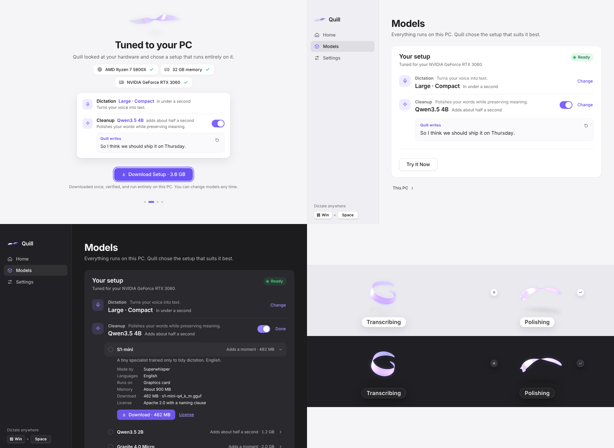

<p align="center">
  
</p>

<h1 align="center">Quill</h1>
<p align="center"><b>Your voice, written — instantly and privately.</b><br>
Press <kbd>Win</kbd> + <kbd>Space</kbd>, speak, and your words appear wherever you type. Everything runs on your PC.</p>

---

## What it is

Quill is a voice-dictation app for Windows that uses **only local AI models**. There is no account, no cloud, no upload: audio is captured, transcribed by [whisper.cpp](https://github.com/ggml-org/whisper.cpp) on your own processor or graphics card, and the text is inserted at your cursor.

- **Win + Space, anywhere.** Tap to start and tap to finish — or hold while you speak and release. `Esc` cancels.
- **Tuned to your PC.** Quill reads your processor, memory and graphics card and recommends the model that suits them, with clear picks for *Recommended*, *Highest accuracy*, *Fastest* and *Lightest*.
- **It just works.** The GPU engine is used automatically when it's clearly faster; if it can't start (or ever crashes) Quill falls back to the CPU without you noticing. Downloads resume and are verified. Your clipboard is restored after inserting.
- **Optional Cleanup.** A small local language model can polish what you said — fillers gone, punctuation fixed, *"at 3, no wait, at 4"* resolved — while keeping your meaning, tone, language, names and numbers. It never answers or follows what you dictate, and it never runs in the cloud.
- **A living indicator.** A small ribbon of pearlescent glass that responds to your voice.

## The ribbon

Quill's identity is a tiny floating ribbon of folded glass — pearl on the outside, lit by a soft violet light within. It's a real 3D surface: the ribbon is deformed in a vertex shader, normals come from the deformed surface, and the material combines thin-film iridescence, Fresnel reflection of a studio environment, and violet light that leaks out wherever the glass bends or twists. Overlapping folds are composited with depth peeling so translucent layers stack correctly, and it casts a soft projected shadow.

It is always **one continuous object**: every state is a set of spring targets (SwiftUI-style `response`/`dampingFraction` springs), so transitions are never cuts — only the same thing changing shape.

| State | What you see |
|---|---|
| **Activating** | A point of light unfolds into the ribbon along its own path, with a soft spring. |
| **Listening** | The ribbon holds its shape with a barely-there breath. A steady **● Listening** label makes the open mic unmistakable. |
| **Speaking** | Your voice launches waves from the centre that travel out to the tips. Quiet speech makes delicate ripples; louder speech makes broader bends. A short voice-energy history drives the waves, so syllables visibly travel. |
| **Processing** | It curls into a loose loop; a glint of light circles the fold. |
| **Polishing** | With Cleanup on, the same loop loosens toward its resting form and its light softens — the text is nearly done. Hover for **Insert as spoken** (skip the polish) or cancel. |
| **Text inserted** | One satisfying settle, a single sweep of light, then it folds back into a point and is gone. |
| **Error** | A small head-shake and a plain-language message. |

Design rules it follows: a stable footprint (it animates inside a fixed window and never moves over your work); controls (cancel ✕, finish ■) emerge beside it only on hover; the window is click-through everywhere else and never steals focus; one material, one accent colour. **Reduced motion** (Windows "Animation effects" off, or Settings › Motion) keeps the silhouette still and carries every state through light alone. Machines without WebGL2 — or whose GPU context is lost — get an SVG ribbon with the same choreography, swapped in mid-flight.

Try it in a browser: `npx vite`, then open `http://localhost:5199/playground.html`.

## Hardware-aware recommendations

Quill estimates, for every model, the time to transcribe a typical 10-second sentence and the memory it needs on *your* machine (calibrated against whisper.cpp benchmarks; see `src/shared/recommend.ts`):

- **Device:** a discrete GPU with ≥ 2 GB VRAM and a Vulkan driver → GPU; integrated graphics → CPU (it's usually not faster); the choice can be overridden in Settings.
- **Fit:** models must fit comfortably in VRAM (GPU) or in a share of available RAM (CPU).
- **Picks:** *Recommended* balances accuracy, latency, memory and download size; *Highest accuracy* is the most accurate model that still answers within ~4 s; *Fastest* and *Lightest* do what they say.

Examples: an RTX 3060 gets *Large · Compact* on the GPU in ~0.7 s; a 4-core Iris Xe ultrabook gets *Small · Compact* on the CPU; a 4 GB Celeron laptop gets *Tiny*.

With Cleanup the plan covers both models (estimates for a typical sentence): the RTX 3060 adds *Qwen3.5 4B* on the same card (+0.6 s); a 6-core desktop without a graphics card adds *S1-mini* for English (+0.6 s) or *Granite 4.0 Micro* for Spanish (+2.3 s); the Celeron gets no cleanup, with the reason shown. The speed model is calibrated against measurements of every catalog model and pinned by a test.

## Cleanup

Two roles, one setup:

- **Dictation** turns your voice into text (whisper.cpp).
- **Cleanup** polishes your words while preserving meaning (a small language model in llama.cpp).



The pipeline is *audio → dictation model → transcript → optional cleanup → insertion*. Cleanup is faithful by default: it removes fillers, stutters and false starts, fixes punctuation and capitals, and resolves clear spoken corrections — nothing else. Every result passes a strict guard (no new words or joining words, numbers kept, negations kept, corrections either resolved or left as spoken, identifiers verbatim, same language, no answering); anything it rejects, and any error, timeout or cancellation, inserts the transcript as spoken. Long dictations are cleaned piece by piece, each piece guarded on its own.

The curated models — **S1-mini** (English specialist, 462 MB), **Qwen3.5 2B**, **Granite 4.0 Micro** and **Qwen3.5 4B** — were chosen for faithfulness, speed, memory, English and Spanish, llama.cpp support and permissive licenses. Sources, measured results and the models considered and left out are in [docs/cleanup-models.md](docs/cleanup-models.md). CI measures every model on an English/Spanish evaluation set (`npm run eval:cleanup`).

Quill plans dictation and cleanup **together** for your PC: both stay loaded, so they must fit side by side with each engine's runtime and room for everything else you run; cleanup goes on the graphics card when there's space left after dictation, otherwise on the processor; and it's recommended only when it adds little time. Your own choices are always kept.

Speed comes from three things in the cleanup engine: the instructions are evaluated once and cached (KV cache for dense models, a state snapshot for hybrid ones), dense models draft ahead from the transcript itself (speculative decoding with output identical to plain greedy decoding), and the draft length adapts to what checking a draft costs on your hardware.

## Architecture

```
Electron main (TypeScript)               native/ (Rust)
├─ dictation state machine               ├─ quill-native   ← Win32: WH_KEYBOARD_LL hook (Win+Space,
├─ hotkey (native hook / fallback)       │                    Start-menu suppression, Esc capture),
├─ engine manager ─ GPU→CPU fallback ──▶ │                    SendInput paste/type, DXGI GPU probe
├─ cleanup manager ─ GPU→CPU fallback ─▶ ├─ quill-engine   ← whisper.cpp (CPU and Vulkan builds),
├─ model downloads (resume + SHA-256)    │                    JSON-lines protocol over stdio
├─ hardware profile + recommendations    └─ quill-cleanup  ← llama.cpp (CPU and Vulkan builds): cached
│  (dictation + cleanup, planned together)                    prompt, transcript drafting, cancellation
└─ windows: overlay (transparent, non-activating, click-through) · app (Mica)

Renderers (Vite + TypeScript, no framework)
├─ overlay: ribbon (WebGL2) + AudioWorklet capture at 16 kHz + synthesized sounds
└─ app: onboarding, Home, Models, Settings
```

Captured audio is trimmed with an adaptive voice-activity detector and level-normalized before transcription; nothing is sent when no speech is detected. Transcripts are cleaned of Whisper's non-speech annotations and stock hallucinations, support "new line" / "new paragraph", and get smart spacing when you keep dictating into the same window.

## Building

Requirements: Node 22+, Rust (stable), CMake, LLVM/libclang (for whisper.cpp bindings) and — for the GPU engine — the [Vulkan SDK](https://vulkan.lunarg.com/).

```bash
npm install
npm run build:native                       # quill-native + CPU engine → resources/bin
npm run build:native -- --vulkan --compat  # also the Vulkan GPU engine and the pre-AVX2 CPU engine
npm run build:native -- --cleanup          # also the cleanup engine (add --vulkan for its GPU build)
npm run dev                     # run Quill with hot-reloading renderers
npm test                        # unit tests (recommendations, audio, text, cleanup guard and prompts;
                                #   the cleanup engine against a tiny generated model once it's built)
npm run eval:cleanup -- --download   # measure every cleanup model on real dictations (downloads ~6.6 GB)
npm run dist:win                # Windows installer → release/
```

Engine builds are portable: whisper.cpp is compiled for an AVX2/FMA/F16C baseline (never `-march=native`), plus a compatibility build for processors without AVX2 that Quill selects automatically. The GitHub Actions workflow builds all three engines and the installer on `windows-latest` and uploads it as an artifact.

## Releases and updates

Quill updates itself. A few seconds after launch (and every few hours) it checks this repository's GitHub Releases; when a newer version exists it says so in the app, the tray and a notification, downloads **only the changed parts** of the installer when you click Download (differential updates via blockmaps), and installs on **Restart to Update** — or automatically the next time Quill quits. It never restarts mid-dictation, and your settings and voice models are left untouched.

To ship a version:

```bash
npm version 0.2.0 --no-git-tag-version   # bump package.json
# edit resources/release-notes.md          # shown on GitHub and in the in-app prompt
git commit -am "Quill 0.2.0" && git tag v0.2.0 && git push && git push origin v0.2.0
```

The tag triggers CI to build the installer (or run the **Build** workflow manually with *release* ticked). Only once the end-to-end dictation test passes does it publish the GitHub Release (installer, blockmap and `latest.yml` feed), and it then self-tests the live feed: the freshly built app pretends to be an older version, finds the release and downloads it. Updates need the repository (or its releases) to be public.

## Project layout

```
src/main/        Electron main process
src/preload/     contextBridge APIs (sandboxed renderers)
src/renderer/    ribbon/, overlay/, app/, playground/
src/shared/      models catalog, recommendations, audio + text processing (unit-tested)
native/          Rust sidecars
resources/       icons (rendered from the real ribbon: `npm run icons`)
```

## Known limitations

- **Administrator windows.** Windows doesn't let a normal app's keyboard hook or synthetic input reach windows running as administrator, so Win + Space and pasting don't work while an elevated app is focused.
- **First run needs one download.** Models aren't bundled (they're 57 MB – 3 GB); Quill downloads the ones you pick, once.
- **Cleanup needs an AVX2 (or ARM) processor** — or a graphics card with room for it. On older PCs Quill hides it and dictation works exactly as before.
- **Win + Space is Windows-only.** On macOS and Linux Quill falls back to a standard global shortcut (press to start, press to finish).

## Privacy

Speech recognition and cleanup run entirely on your device; there is no cloud fallback of any kind. Quill makes exactly one kind of network request for this: downloading a model you choose from Hugging Face (whisper.cpp's repository for dictation; the cleanup model's publisher for cleanup), plus checking GitHub for app updates. Recent dictations — and, with Cleanup, the transcript as spoken — are kept in memory only and vanish when Quill quits.

## License

MIT
